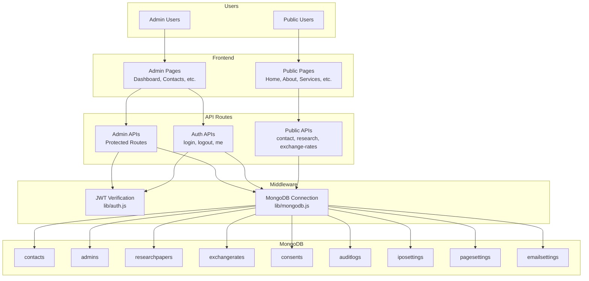
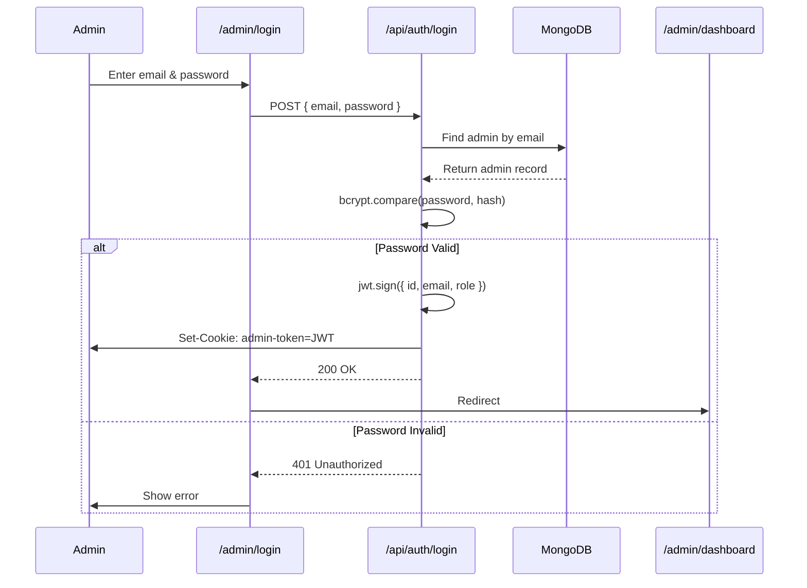
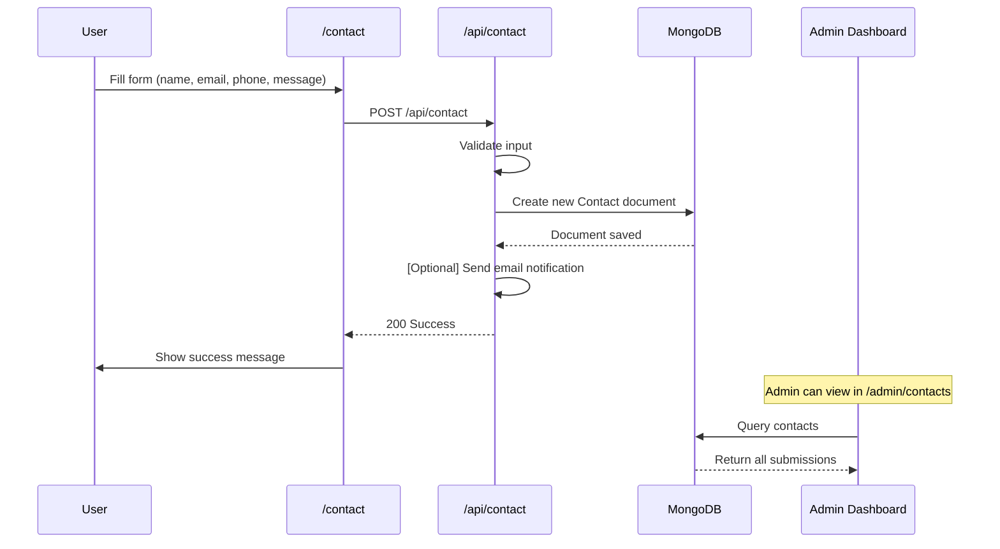
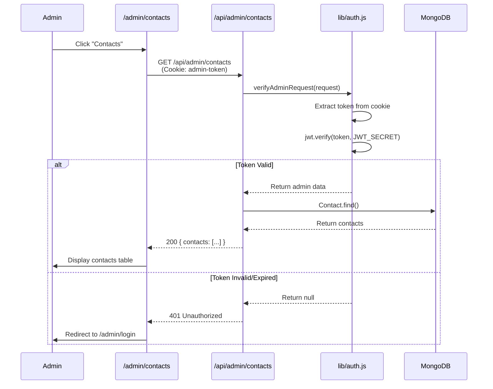
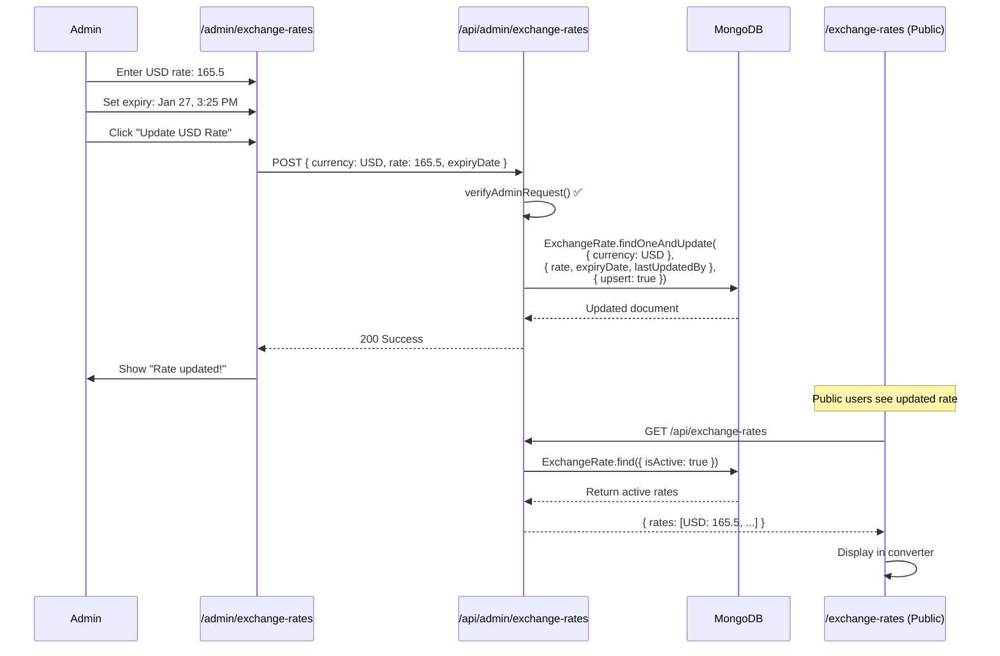
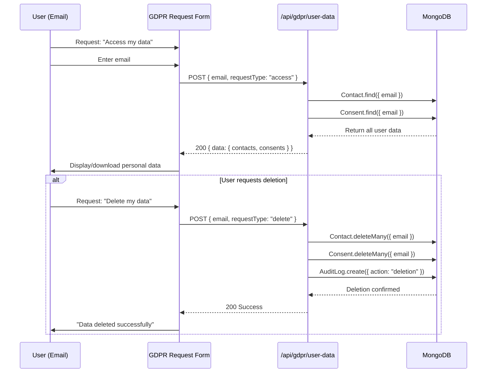
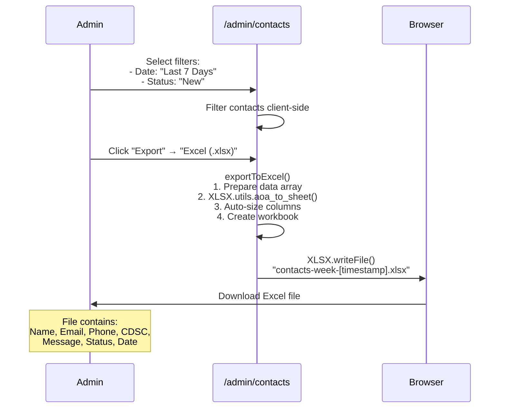

# AIB-AXYS AFRICA - DATA FLOW DIAGRAMS (Mermaid)

## Complete System Architecture



## Authentication Flow



## Contact Form Submission Flow



## Protected Admin Request Flow



## Exchange Rate Update Flow



## GDPR Data Request Flow



## Admin Contacts Export Flow



---

## Security Boundary Map

```mermaid
graph LR
    subgraph Public_Zone[Public Zone - No Auth]
        PU[Public Users]
        PF[Public Pages]
        PA[Public APIs]
    end
    
    subgraph Auth_Boundary[Authentication Boundary]
        LOGIN[/api/auth/login]
        JWT[JWT Verification]
    end
    
    subgraph Protected_Zone[Protected Zone - Auth Required]
        AP[Admin Pages]
        AA[Admin APIs]
        PII[PII Data Access]
        CRUD[Data Modification]
    end
    
    subgraph Database[Database Layer]
        DB[(MongoDB)]
    end
    
    PU --> PF
    PF --> PA
    PA --> DB
    
    PU --> LOGIN
    LOGIN --> JWT
    JWT --> Protected_Zone
    
    AP --> AA
    AA --> JWT
    AA --> PII
    AA --> CRUD
    PII --> DB
    CRUD --> DB
    
    style Auth_Boundary fill:#ff6b6b
    style Protected_Zone fill:#51cf66
    style Public_Zone fill:#4dabf7
```

---

**For full architectural details, see SECURITY_AUDIT_ARCHITECTURE.md**
